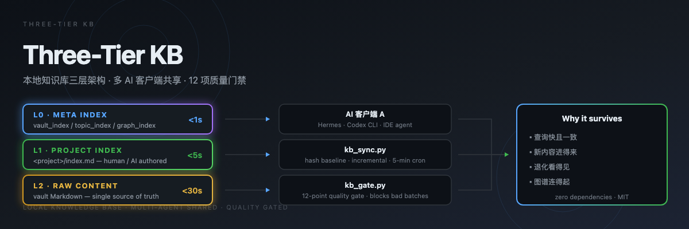

<div align="center">

</div>

<div align="center">

# Three-Tier KB

**本地知识库三层架构 · 多 AI 客户端共享 · 12 项质量门禁**

[English](README_EN.md) · [安装](#安装) · [快速开始](#快速开始) · [文档](#文档)

[](LICENSE)
[](https://www.python.org/)
[](https://pypi.org/)
[](https://obsidian.md/)

</div>

---

## 这是什么

一个**可执行的本地知识库构建方案**，不是方法论。

把散落在多个 AI 客户端、多个工作区的文件，变成一个**任何客户端都能秒查、结果始终一致、每次改动都有验证**的知识库。

包含 3 个可直接运行的 Python 脚本（零第三方依赖）+ 5 份实战沉淀文档 + 2 套模板。

```bash
git clone https://github.com/zhoudibo/three-tier-kb.git
cd three-tier-kb/skills/three-tier-kb/scripts
python3 kb_index.py --vault ~/Documents/my-vault --init
python3 kb_index.py --vault ~/Documents/my-vault --build
python3 kb_gate.py ~/Documents/my-vault
```

---

## 解决什么问题

单层「全库扫描 + 全文匹配」在文件量过千后会同时踩三个坑：

| 症状 | 真实问题 | 三层架构的答案 |
|---|---|---|
| 找东西要找很久 | 全库扫描 O(n) | **L0 元索引** 预计算，<1s |
| 搜出 200 条不知看哪条 | 没有优先级 | **L0 优先**，同关键词分层命中 |
| A 客户端和 B 客户端答案不一样 | 各查各的 | **统一查询接口**，结果一致 |

---

## 三层架构

| 层 | 名称 | 响应 | 内容 | 谁维护 |
|---|---|---|---|---|
| **L0** | 元索引 | `<1s` | `vault_index.json` / `topic_index.json` / `graph_index.json` | 脚本自动重建 |
| **L1** | 项目索引 | `<5s` | `<项目>/索引.md` | 人 / 定向 AI 语义判断 |
| **L2** | 原始内容 | `<30s` | vault 内全部 Markdown | **唯一真相源** |

**硬规则：同一关键词命中多层时，L0 永远优先。**

```
        ┌──────────────┐  ┌──────────────┐  ┌──────────────┐
        │  AI 客户端 A  │  │  AI 客户端 B  │  │  AI 客户端 C  │
        └──────┬───────┘  └──────┬───────┘  └──────┬───────┘
               └────────┬────────┴────────┬────────┘
                        │  kb_sync.py（哈希基线增量，5 分钟 cron）
                        ▼
              ┌─────────────────────────────────────┐
              │      L2 · 原始内容（vault）           │ ← 唯一真相源
              └───────────────┬─────────────────────┘
                              │ kb_index.py --build（每日基线）
                              ▼
              ┌─────────────────────────────────────┐
              │      L0 · 元索引（JSON，可重建缓存）    │ ← 机器层
              └───────────────┬─────────────────────┘
                              │ 查询路由（L0 优先）
                              ▼
              ┌─────────────────────────────────────┐
              │      L1 · 项目索引（Markdown，语义层）  │ ← 人写
              └─────────────────────────────────────┘
```

---

## 三个脚本

### `kb_index.py` — 索引引擎

构建 L0 元索引 + 三层查询路由。

```bash
python3 kb_index.py --vault ~/Documents/my-vault --init     # 生成配置模板
python3 kb_index.py --vault ~/Documents/my-vault --build    # 构建 L0
python3 kb_index.py --vault ~/Documents/my-vault --query "关键词"
```

查询输出带层级标记，多层命中自动按 L0→L1→L2 排序去重：

```
🔍 「video」 命中 4 条 (agent=Hermes)

 1. [L0] project · 短视频项目
    智能体/AgentA/项目/短视频项目/索引.md
 2. [L2] raw · 00_总导航.md
```

### `kb_gate.py` — 质量门禁

12 项检查，**只读**，不改任何文件。

```bash
python3 kb_gate.py ~/Documents/my-vault
```

```
[2/12] 孤儿文件（无入链且无出链）...
  ⚠️  WARN  孤儿 2 个: 空文件.md、智能体/AgentB/项目/项目Beta/孤儿文件.md
[7/12] 敏感文件与凭据扫描...
  ❌ FAIL  敏感文件 credentials.json / 疑似凭据内容

检查结果：4 PASS / 7 WARN / 1 FAIL（共 12 项）
❌ 拦截：有 FAIL，禁止带病上线，回滚该批后重跑
```

退出码 `1` = 有 FAIL（可直接用于 CI / cron 拦截）。

**检查项**：库结构与入口 · 孤儿文件 · 断链 · frontmatter 9 字段 · 出链覆盖 · 入链覆盖 ·
敏感文件与凭据 · 重复标题 · 空文件 · 日期有效性 · 索引一致性 · 图谱密度

### `kb_sync.py` — 增量同步

多客户端 → vault 增量同步，哈希基线驱动。

```bash
python3 kb_sync.py --vault ~/Documents/my-vault --scan ~/workspace --route --dry-run
python3 kb_sync.py --vault ~/Documents/my-vault --scan ~/workspace --route
```

三态判定：**新增 / 变更 / 未变**（基于内容 hash，不是 mtime）。

---

## 为什么值得做

知识库最难的不是「建」，是**让它一直活着**。

真实落地里，库崩溃的顺序通常是：
文件进不来 → 索引不同步 → 图谱散架 → 没人信它 → 没人维护它。

每一层都在对抗其中一环：

- 三层索引 → 查询**快且一致**，agent 才愿意用
- 哈希基线同步 → 新内容**进得来**，库才不空
- 12 项门禁 → 退化**看得见**，才能早修
- cluster 互链 → 图谱**连得起**，人愿意翻

单独任何一环都不够。

---

## 文档

| 文档 | 内容 |
|---|---|
| [`references/three-tier-architecture.md`](skills/three-tier-kb/references/three-tier-architecture.md) | 三层职责边界、查询路由、会话库 FTS5、架构决策记录 |
| [`references/sync-protocol.md`](skills/three-tier-kb/references/sync-protocol.md) | 哈希基线、三重过滤、空格安全、原子写、故障排查 |
| [`references/quality-gate-guide.md`](skills/three-tier-kb/references/quality-gate-guide.md) | 12 项检查详解、修复优先级、frontmatter 规范、批量修复安全姿势 |
| [`references/index-configuration.md`](skills/three-tier-kb/references/index-configuration.md) | `index_dirs` / `topic_map` / `project_keywords` 配置详解 |
| [`references/graph-view-repair.md`](skills/three-tier-kb/references/graph-view-repair.md) | 力导向布局原理、cluster 互链策略、孤儿归零协议 |

---

## 安装

### 方式一 · 作为 Hermes Skill

```bash
git clone https://github.com/zhoudibo/three-tier-kb.git \
  ~/.hermes/skills/note-taking/three-tier-kb

hermes skills list | grep three-tier-kb
```

### 方式二 · 独立使用

三个脚本零第三方依赖，Python 3.9+ 直接可用：

```bash
git clone https://github.com/zhoudibo/three-tier-kb.git
cd three-tier-kb/skills/three-tier-kb/scripts
python3 kb_gate.py --help
```

### 配置 cron（可选）

```bash
# 5 分钟增量同步
*/5 * * * * python3 ~/path/to/kb_sync.py --vault ~/Documents/my-vault --scan ~/workspace --route

# 每日基线重建 + 质量体检
30 17 * * * python3 ~/path/to/kb_index.py --vault ~/Documents/my-vault --build \
  && python3 ~/path/to/kb_gate.py ~/Documents/my-vault
```

---

## 目录结构

```
three-tier-kb/
├── README.md
├── README_EN.md
├── LICENSE
├── docs/
│   └── real-world-lessons.md     # 实战经验全记录（含踩坑）
├── skills/three-tier-kb/
│   ├── SKILL.md                  # Hermes Skill 主文件
│   ├── references/               # 5 份实战文档
│   ├── templates/                # 知识卡 / 项目索引模板
│   └── scripts/                  # 3 个可执行脚本
└── assets/
    └── banner.svg                # 仓库 Banner
```

---

## 红线（不可违反）

- 扫描必须统一过滤 `.git/` `.obsidian/` `node_modules/` `__pycache__/` `.venv/` 等
  —— 过滤漂移会产生幽灵条目
- shell 遍历带空格文件名用 `while IFS= read -r`，禁止 `for f in $(find ...)`
- **禁止用正则批量扫描改写 Markdown 正文** —— 必须用 DOM 解析
- `.env` / `*credentials*` / token 一律不进库，日志只写路径不写内容
- 不要为每类资源单独建索引文件 —— 应在已有项目索引内嵌 wikilink
- 删除既有文件、或把内容推送到库外，必须先拿到用户明确授权

---

## 常见问题

**Q: 为什么基线要「从零重建」而不是增量更新？**
增量更新一旦漏掉一次删除，索引就永久漂移（幽灵条目）。从零重建慢一点，但**永远自愈**。

**Q: 为什么同步用 5 分钟 cron 而不是实时监听？**
实时监听在多客户端并发写入时锁竞争严重、崩溃后状态难恢复。5 分钟窗口足够小，失败可重试，日志可回溯。

**Q: 门禁第一次跑必然 FAIL，是不是坏了？**
不是，这是设计。真实库第一次体检必然发现问题。预期迭代 3-6 轮把 FAIL 清零。

**Q: 脚本说「0 孤儿」，Obsidian 图谱里还是散？**
脚本与 GUI 渲染逻辑不完全一致，以 GUI 为准。检查每个文件是否有 ≥3 条出链（力导向布局阈值）。

---

## License

MIT © [zhoudibo](https://github.com/zhoudibo)

---

<div align="center">
<sub>如果这套方法帮到了你，点个 ⭐ 让更多人看到</sub>
</div>
